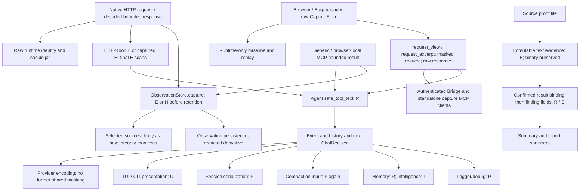

# KAgent — Redaction architecture audit & simplification design

**Kết luận: DESIGN READY WITH LIMITATIONS.** Khuyến nghị **B — bỏ redaction khỏi dữ liệu kiểm thử cục bộ, giữ bảo vệ có mục tiêu tại các kênh xuất dữ liệu**. Chưa triển khai A/B/C. Operator cần chọn phương án và chấp nhận chính sách đưa response của target vào external LLM trước phiên implementation.

Audit ngày **2026-10-13, Asia/Saigon**. Source baseline là HEAD `8fb8d9ecf56549473417776332665bcc35d95b60` **cộng worktree patch hiện có**, không phải HEAD thuần. Đây là báo cáo kỹ thuật về dữ liệu và trust boundary, không phải finding về một target.

## 1. Executive summary và baseline

Redaction hiện tại không chỉ là masking trên màn hình hoặc trước khi gửi LLM. Nó biến đổi response tại `HTTPTool._dispatch`, tại `ObservationStore.capture`, khi tạo immutable text evidence, khi Agent nhận tool output, khi compact/lưu session, và ở các kênh presentation/export. Có lớp bảo vệ boundary khác nhau thực sự cần giữ; cũng có nhiều lần quét lại cùng nội dung, với semantics không nhất quán.

Các kết quả chính đã chạy offline:

- Capture patch giữ nguyên response string trong `request_view`/`request_excerpt`. Native/MCP capture getter và Bridge có thể xuất response này. **Agent vẫn che lại JSON token**, nên patch chưa tạo được response fidelity end-to-end cho mọi content type.
- `{"token":"hello"}` trở thành `{"token":"[REDACTED]"}` trong request LLM kế tiếp và session resume. HTML `<input type="password" value="pw7">` giữ nguyên cả trong LLM context và session. Hệ thống hiện tại không bảo đảm rằng mọi credential đều được che.
- `apply_evidence` che public SHA256 chỉ vì hình dạng digest; Native HTTP observations và immutable text proof mất checksum. Capture body đi qua Agent dùng `redact_payload` thì checksum này còn nguyên. Không được gọi chung tất cả các đường là một sanitizer.
- Known-credential replacement của capture coi cookie value `blue` là secret ở mọi substring: `color=blue` thành `color=[REDACTED]`. Nó còn có thể che cả `sid=blue` như một cụm. Response passthrough của patch không dùng replacement này, nhưng request URL/body và captured HTTP replay vẫn dùng.
- Hai body `{"token":"red"}`/`{"token":"sky"}` bị làm giống nhau. SQLi TRUE/FALSE khác rows/count và IDOR khác owner/profile trong bộ fixture vẫn phân biệt được. Tác động phụ thuộc nội dung, không phải mọi pentest đều hỏng.
- Regex Cookie chạy trên serialized JSON có thể ăn delimiter và phần còn lại. Native getter trả pretty JSON vẫn parse được nhưng mask drift qua save/compaction. Với compact JSON, và **production generic `MCPTool.run` được cấp RPC double offline**, output sau `safe_tool_text` có thể không còn parse được. `safe_tool_text` chấp nhận nonempty string; nó không xác minh structured result còn hợp lệ.
- Cookie jar runtime vẫn tái dùng cookie đúng origin/identity, từ chối khác origin/identity và xóa khi revision đổi. Masked context không đồng nghĩa mọi cookie reuse bị hỏng; thấy token cũng không đồng nghĩa được cấp quyền dùng token.

**Giới hạn quan trọng của B:** raw target response đưa vào external LLM có thể chứa token, mật khẩu hoặc dữ liệu người dùng. Giữ header masking không bảo vệ được secret nằm trong body hay credential echo. B không được quảng cáo là vừa giữ nguyên mọi response vừa bảo đảm không secret nào ra ngoài.

### Baseline được bảo toàn

Đã đọc `AGENTS.md`, HEAD, status và existing diffs. Bảy tracked files đã modified trước audit:

```text
src/browser/mcp_server.py
src/browser/redacted_view.py
src/tools/common/browser_capture.py
tests/browser/test_browser_mcp_server.py
tests/browser/test_server.py
tests/integration/test_burp_offline_audit.py
tests/tools/test_browser_capture.py
```

Untracked đã có: `tests/browser/test_response_passthrough.py`. Đã lưu hash của tracked/untracked source files và baseline diff ngoài repository để đối chiếu cuối phiên. Không sửa Browser/Burp Capture patch, `related_requests`, production, existing tests, permissions, scope, Evidence TOCTOU hoặc `Observation.complete`. Không reset/clean/restore/install/commit/push; không dùng live HTTP, external LLM hoặc benchmark.

Chỉ mở rộng source theo shared-redactor callers và đường tiếp tục của dữ liệu. Không đánh giá lại toàn bộ transport/Burp ownership hay provider configuration transaction. Những phần đó chỉ được đọc để xác định boundary; không có kết luận audit mới về implementation ngoài redaction.

## 2. Redaction inventory và call graph

### 2.1 Vocabulary và redactor thực tế

| Ký hiệu | Source:function | Contract thực tế |
|---|---|---|
| R | `src/redaction/redact.py:Redactor.apply` / `apply` (406/468) | Quét text: private-key block, decoded JSON secret keys, JSON regex, form, 24 regex patterns. Không phải entropy detector tổng quát. Có broad header-name regex và Cookie regex không anchor. |
| P | `redact.py:redact_payload` (177) | Recursive mapping/list/tuple; secret field có thể bị thay cả subtree bằng marker. Strings chạy R trước, rồi thử parse JSON và recursive scan; có form/multipart handling. Key normalization bỏ ký tự ngoài `[a-z0-9]`. |
| Q | `redact.py:redact_request_context` (150) | JSON/form/multipart request skeleton; JSON invalid có thể thành toàn bộ `[REDACTED]`; valid JSON bị reserialize compact. Không bảo toàn byte/whitespace. |
| E | `redact.py:apply_evidence` (472) | R cộng blanket hex digest lengths 32/40/64/96/128. Có ngoại lệ digest-shaped hostname. Không phải bằng chứng rằng hex là secret. |
| H | `redact.py:http_credential_redactor` (483) | Header được coi nhạy cảm nếu E thay đổi `name: value`; thu cả full value, Authorization token và Cookie values. Replacement toàn text, sau đó E. Short secret <4 dùng word boundaries; từ 4 trở lên dùng substring replace. |
| D | `src/tools/common/approval_display.py:redact_approval` (19) | Credential CLI flags/assignments, Basic/Bearer, `-u user:password`, rồi R. Display only, không thay execution args. |
| U | `src/ui/render/sanitize.py:sanitize_text` (10) | Escape terminal controls, đổi CRLF, xử lý dangling private-key block, P rồi D. Có chức năng an toàn terminal ngoài secret masking. |
| I | `src/intelligence/store.py:redact` (1260) | E rồi `DEFAULT_REDACT_PATTERNS`; pattern riêng che labelled assignments. Khi caller truyền custom patterns thì bỏ E. |

`mask` (349) không luôn trả marker cố định: thường giữ hai ký tự đầu/cuối và độ dài theo bucket. P đối với secret field thường chuyển thành `[REDACTED]`. Các lớp có thể chuyển partial mask thành full marker hoặc làm mask drift. `{INJECTION_POINT}` nguyên vẹn được exempt; form marker URL-encoded có exemption riêng. Compound marker nằm trong secret value không được exempt.

### 2.2 Call graph theo dữ liệu



Arrow tới durable không nói mọi transcript tự động được copy: memory có tool/schema riêng, intelligence có extraction/normalization. `LOG` cũng gồm tool-call args, errors và metadata từ callers, không chỉ sanitized history.

### 2.3 Production inventory

“Lặp” ghi lớp sau có thể che tiếp; “boundary nếu bỏ” ghi hệ quả bỏ tại đúng điểm, không mặc định toàn hệ thống raw.

| Source:function | Input → output; che gì | Nơi tiếp tục / lặp | Boundary nếu bỏ |
|---|---|---|---|
| `src/tools/http/http_tool.py:_prepare_with_diff`, `_execute_invocation`, `_dispatch` (388/471) | Request thực thi giữ raw; `_dispatch` nhận bounded **decoded** response bytes. Ordinary dùng E, captured replay dùng H cho body/request preview/header values. Cuối `_dispatch` E trên full text; `_execute_invocation` E lần nữa trên assembled hops. | ToolOutput → Agent P → history/LLM/UI/save. Raw bytes chỉ còn transient tại dispatch và cookie extraction. | Gỡ scan body phục hồi fidelity cho Agent nhưng thay cả kênh LLM và persistence ở downstream; direct caller cũng thấy raw hơn. Gỡ scan request preview có thể lộ credential request. |
| `src/tools/http/context.py:HTTPContextStore.extract/add_identity/sync_target` | Raw Cookie/Authorization giữ trong runtime exact-origin + identity jar. Không dùng shared redactor. Không extract JSON bearer token/CSRF body. | Request tiếp theo; không persist jar qua shared session serializer. | Đây đã là đường raw cần giữ. Mask output không làm jar mất cookie. |
| `src/permission/network/grants.py:EffectiveHTTP.preview/redact_preview` (163/172) | Raw effective action → H nếu captured, rồi D. | Permission modal U; args/action/digest vẫn raw. | Bảo vệ người đọc preview/screenshots, không cấp scope hay quyền mới. Giữ representation sanitization. |
| `src/browser/store.py:CaptureStore.ingest/ingest_snapshot/ingest_burp_issue` (194/323/466) | Store nhận raw fields; cap response string 65536 chars; oversize string có suffix. Raw request b64 riêng capped 96 KiB; snapshots capped count; records bounded. Không shared redaction. | Baseline runtime; views; Bridge. | Raw ở RAM đã tồn tại. Không xóa bounds/lifetime/ownership vì chúng không phải redaction. |
| `src/browser/redacted_view.py:_headers/request_view` (18/32) | Bỏ raw request b64/oversize fields khỏi view. Headers E rồi H; request body Q/H hoặc P/H; URL bỏ userinfo rồi H. **Response body passthrough** theo patch. Fields khác không được sanitize toàn bộ. | Native tools; standalone MCP; Bridge; Agent P. | Header/request guards bảo vệ credential view. Bỏ body scan ở đây đã được operator chọn ở patch; không sửa lại. |
| `redacted_view.py:request_excerpt` (84) | View + exact string slice; cap int 0..65536, default 4000; hai aliases `response_body` và `responseBody`; truncation flag riêng. | Native `BrowserCaptureGetTool.run` (230), MCP getter (314); P tại Agent. | Không redaction response tại đây. Duplicated aliases tăng context; không thay aliases trong audit. |
| `src/browser/server.py:Handler.do_GET` (154) | Host + bridge token gate trước read. `/requests` → request_view, tasks → task_view, issues → issue_view; `/endpoints` gửi store endpoint summaries trực tiếp. | Client sở hữu bridge token. Không có Agent P trên HTTP response này. | Bỏ guards làm client thấy thêm request creds. Response body raw **đã** tới client. Bridge token không tự lọc engagement origin. `/endpoints` raw query routing cần ghi nhận, không giả định route nào cũng sanitized. |
| `src/browser/mcp_server.py:main/call_tool` (277–337) | Standalone capture MCP dùng request_view/excerpt/snapshot_view, stdio text JSON. Không generic P cuối cùng ở server. | MCP client; nếu nhập lại KAgent qua generic integration thì Agent P. | Client có thể nhận raw captured body ngay; request/header/snapshot guards vẫn quan trọng. |
| `src/tools/common/browser_capture.py:BaseCaptureTool.bind_execution_policy`, capture getter/list/snapshot/issues/tasks | Bound `ScopedCaptureStore` lọc scope/receipt. Lists giữ limits/output cap. Getter export request_excerpt, có thể thêm `runtime_observation_id` bằng import_capture. | Agent P; getter không blanket redact body. | Loại view guards không được loại scope filtering; body visibility và evidence view hiện có thể khác nhau. |
| `redacted_view.py:issue_view/task_view/snapshot_view` (96/107/116) | Issue raw request/response b64 omitted, selected prose P; task raw request b64 omitted và notes/URL E; snapshot document_cookie/cookie values/storage values che toàn bộ, kể cả `theme=blue`. | Tool/Bridge/MCP → Agent P nếu qua Agent. | Snapshot là export một credential store, nên giữ allowlist metadata; che mọi storage value làm mất nonsecret app state nhưng không cần HTML/JS sanitizer. |
| `src/browser/selection.py:SelectedCapture.from_request` (59) | Reject unsafe retrieval IDs dùng R; display endpoint dùng request_view/E. Raw baseline reference/signature riêng. | Selection prompt/UI, workflow binding. | Không remove ID validity/ownership checks cùng masking; đây không chỉ là display text. |
| `src/browser/server.py:event_text` (313) | Event URL/target scrub control + E, không đưa response body vào event notification. | CLI/TUI/log callers có thể tiếp tục U/P. | Display/log boundary; giữ bounded metadata thay full traffic. |
| `src/agent/agent.py:run_parsed_tool_call/_tool_result_event/record_tool_result` (5300+/5435/5486) | Raw ToolCallResult vẫn transient; `_tool_result_event` safe_tool_text/P cho result/error; receipt acceptance kiểm tra raw result riêng. Event result dùng chung cho UI/history/working. Status/http_status/truncated giữ riêng. | Next `_request_for_messages` → providers; Session P; UI U; compaction P. | Điểm quyết định outbound LLM, không phải display-only. Bỏ blanket P toàn tool sẽ mở file/shell/arbitrary MCP output nữa; B chỉ cho trusted in-scope HTTP representation. |
| `agent.py:_planner_event`, error reporting | Decision summary/reason P; caught error text R trước logging/events. | UI U, debug/log P. | Error/decision có thể chứa runtime/provider secrets; giữ bảo vệ ở output. |
| `src/agent/compaction.py:format_history_for_compaction/bounded_history_for_compaction`; `agent.py` wrappers (6115+/6283+) | Scan content và arguments qua safe_tool_text/P; bounded version sanitize thêm clipped content rồi format. Summary do LLM tạo không phải source traffic. | Compaction LLM, session memory; context snapshot. | Có P lặp trên sanitized tool messages; user/model arguments vẫn cần xuất policy riêng. Không cho compaction biến transcript thành bằng chứng gốc. |
| `agent.py:_projection_request/run/_record_assistant_response/_sanitize_response` (1680+/3847/4546) | User/injection text và model content/tool-call arguments vào live history/request; `_sanitize_response` chỉ strip thinking tags, không secret-redact. Session save P tạo bản persisted riêng, không overwrite live message. | Provider encoding raw supplied content; UI U; save/compaction P. | Current Agent **không phải global outbound no-secret firewall**. User input/model credential echo hoặc file mentions cần boundary policy riêng; bỏ tool P chỉ làm mở rộng thêm tool-result path. |
| `src/agent/tool_results.py:ResultRetention.remember/admit`; `src/session/tool_results.py:ToolResultStore.put/resolve` | Nhận **Agent-sanitized** content; store không tự redact. Only reviewed file/shell/http-recon/web adapters eligible, arbitrary MCP excluded; controller provenance/owner/mode/digest/range checks. | `.kagent/tool-results` → gated read_tool_result → Agent P; session references. | Gỡ Agent mask có thể làm cache durable raw ngoài session serializer. Giữ cache contract/bounds/0600; không coi P tại session là bảo vệ cache. |
| `src/session/store.py:_serialize_session` (508/556), `Store.load` (356) | P trên target/memory/workflow/messages, content/arguments/reasoning/Gemini parts; transient workflow context omitted. Private atomic write 0600, dirs 0700. Load reconstructs, không blanket sanitize content lại. | Resume/history/provider request; workflow constructors normalize riêng. | True persistence boundary. Bỏ là raw credentials/prose/provider-state có thể lưu; old redacted data không thể khôi phục. |
| `agent.py:save_context_snapshot` (2023); `session/store.py:save_context_snapshot/_write_context_snapshot` | Conversation qua compaction P, header target và format_memory ghép riêng; writer ghi private Markdown, **không tự P**. | Local context export. | Không được nghĩ serializer session che cả snapshot. Khi raw history được phép, cần policy tại controller snapshot writer; header/memory coverage không phải toàn bộ. |
| `src/permission/runtime/observations.py:ObservationStore.capture/import_capture/capture_output/persist` (125/179/163/85) | Capture E/H **trước** body retention (max 65536 bytes); allowlist response headers; raw response hash khác retained source hash. Import lấy raw patched view rồi capture E lại. Tool output capture E. Persist giữ exact already-redacted envelope nếu retained_hash có; legacy fallback E; VerifiedResult prose E. | Primary sources, manifests, legacy verifier, `.kagent` observation persistence. | Không còn raw primary body sau capture. Bỏ tại RAM đồng thời ảnh hưởng disk vì persist writes exact captured body. Phải tách representation trước khi bỏ, giữ owner/hashes/version semantics. |
| `src/workflow/evidence.py:EvidenceArtifact.capture/capture_immutable_snapshot` (214/224) | `capture` chỉ hash/read metadata, không redact source. Immutable snapshot decode UTF8 → E; non-UTF8 binary giữ raw; digest/id/size của **stored bytes**. | `.kagent/evidence/<candidate>/<sha>.proof`, 0700 dirs/0400 file; result refs. | Snapshot là persistence boundary; hash integrity của derivative đúng, không chứng minh nó là original response. Không bỏ blanket E mà chưa có secret-safe durable contract. Không xét/sửa TOCTOU. |
| `src/workflow/state.py:_text/_request_context`, Candidate/AttackSurfaceInput/ValidationResult constructors (98/107/247/513/807) | Compact candidate strings R, request skeleton Q; confirmation P ≤6000 chars, refs/techniques normalized. | State/session/workflow receipts, fingerprints. | Có normalization liên quan semantic identity và restore; không tháo đồng loạt. Skeleton không thay raw baseline. |
| `src/workflow/assessment.py:begin_attempt/source_row/check_excerpts` (186/41/361) | Related URL E; criteria P. source_row hex-encodes retained body và bỏ retained_hash khỏi hashed source. Excerpt hash/range kiểm tra trên retained body. | Selected sources/result manifest/validation acceptance. | `related_requests` không được sửa. Hex là serialization, không masking/encryption. Raw body phía capture đổi thì source bindings đổi; không được rehash historical records tùy tiện. |
| `src/tools/workflow/workflow_tool.py:_record_evidence/_record_result` (935/1119) | Immutable proof snapshot E; result assessment P trước seal; manifests/evidence IDs là metadata. Artifact refs prose R. | Result/seal/eligibility/finding/session. | Giữ compact contract và reference-based proof; không đưa full raw traffic vào confirmation blob để né masking. |
| `src/tools/workflow/finding.py:ConfirmFindingTool.run/write_summary` (380–399/93) | Title/URL/payload/curl/remediation R, observed impact/responseExcerpt E; candidate result/evidence bindings kiểm tra trước report. Summary dùng presentation sanitizer. | Canonical `artifacts/findings` Markdown, summary/report, UI. | Finding export boundary. Không bỏ mà vẫn hứa report không chứa creds. |
| `src/findings/store.py:Store.save/render` (258/413) | Ghi/render Finding fields như supplied; safe fencing/collision-safe create 0600; không shared-redact lần nữa. | Canonical reports và direct Store callers. | Protection hiện ở tool caller; Store direct không bảo đảm redact. Đừng thêm raw field rồi giả định store có sanitizer. |
| `src/findings/presentation.py:render_summary` (93) | E + supplied sanitizer (default E lần nữa), secret-labelled multiline fields suppressed, URL userinfo removed, credential command guards, Markdown escape. | Shareable summary. | Export boundary và markup safety khác nhau; có redundant E nhưng renderer vẫn cần safe contract. |
| `src/report/builder.py:Sanitizer.text/url`, `build_report` (89/450) | Bounded allowlist-derived report; labelled prose có thể omitted toàn field, URL credentials/query values stripped, proof E/prose R; masked fragments collapsed. Raw traffic/payload/session/config excluded. | Report renderers/PDF. | Giữ report minimization và provenance reconciliation. Bỏ redaction không được bỏ HTML/Markdown/PDF escaping/size constraints. |
| `src/findings/cwe_enrichment.py:mechanism_query` | Minimal mechanism words từ class/title, cắt credential-labelled suffix và URLs/JWT, E cuối, cap 512. | External research/CWE query. | Đây là external query minimization riêng, không duplicate tool response scan. Giữ. |
| `src/ui/core/state.py:reducer/_present_issue/append_entry`, `widgets/transcript.py:_display_text`, CLI `runtime.py:emit` (1607) | Presentation copies U trên assistant, tool summaries, arguments, errors, transcript/copy. Reducer rồi renderer có scan lặp. | Terminal/screenshots/copy. Không sanitize next LLM request. | Display boundary. Có thể giảm scan lặp khi bảo đảm entry đã safe; luôn giữ terminal-control escaping. |
| `src/logger/logger.py:JsonFormatter.format` (60/84); `session_debug.py:FileSessionDebugLog.write` (94/125) | P trên rendered message/extra/exception và JSONL event data; debug strips transient workflow context. 0600 logs, rotation, private dirs. | `~/.kagent/logs`, debug files. | Durable diagnostics boundary. Không chuyển thành raw logging để giúp Agent phân tích. |
| `src/cli/runtime.py:redacted_argv` (426) | Explicit `--api-key`/`--target` slots withheld trước startup metadata log; không shared R. | Logger P. | Exact provider/config credential slots; giữ dù chọn B. |
| `src/memory/store.py:MemoryStore.add` (91) | Fact body R, reject session authorization text; **explicit description không R**. Private Markdown/index. | Project/personal recall → prompt. | Cross-session/project persistence boundary; không được bỏ. Metadata gap đã reproduce, không có full protection hiện tại. |
| `src/intelligence/store.py:normalize_scenario/normalize_list/redact` (1110/1132/1260), summary ingestion | Fields I, summary provenance/untrusted scope rules riêng, truncation/schema. | Project/personal intelligence/search recall → prompt. | Durable transfer boundary; custom regex có duplicate che nhưng removal cần bảo toàn tested labelled-short-secret handling. Authorization exclusions luôn giữ. |
| `src/coverage/store.py:record/annotate`; `src/coverage/context.py:CoverageContext.__post_init__`; `src/workflow/goals.py:RequestedGoal.__post_init__` | Notes/context/reason/ref R. Coverage records và goals không phải full traffic; route identifiers không uniformly redacted toàn store. | Durable coverage, session, planner. | Giữ compact nonsecret state. Gỡ normalization có thể đổi keys/fingerprints; không lợi ích rõ ràng cho HTTP body fidelity. |
| `src/tools/discovery/content.py:_safe_diagnostic` (806) | Scrub printable diagnostic rồi R[:240]. Response fingerprinting tự normalize dynamic/path tokens trên raw bounded body, không shared E. | Discovery tool result → Agent P. | Diagnostic outbound protection giữ. Fingerprint normalization là feature scanner riêng, không được xóa như “redaction”. |
| `src/tools/http/web.py:WebFetchTool/WebSearchTool` | Bounded fetch/search HTML stripping/cache; không shared mask trong producer. | Agent P, optional retained results, observation capture nếu adapter khác gọi. | HTML stripping phục vụ fetch text, không phải response sanitizer của Native HTTP. Không thay hoặc dùng nó cho XSS evidence. |
| `src/tools/mcp/integration.py:MCPTool.summarize/run/_render_policy_result`; `MCPSession._open` stderr handler | Preview args P; run giữ bounded JSON content, không tự P output; policy capture_output E riêng; child stderr E rồi logger P. | Agent P; standalone MCP clients có thể thấy producer raw. | Trusted producer output vs arbitrary remote tool phải phân biệt; không blanket bypass P theo tool name hoặc remote `raw=true`. |
| `src/tools/mcp/browser_local.py` failure paths (512/526) | Browser MCP failure/stderr text E capped 4096. Page/screenshot output chạy qua generic adapter/Agent; không HTML/JS secret sanitizer riêng được chứng minh. | Exception → Agent error/Logger/UI; page output → Observation/LLM. | Giữ diagnostic guard. Image/base64 secrets không được shared text regex đảm bảo che. |
| `src/llm/providers/openai.py:OpenAIClient.encode_request` (403), analogous provider encoding | Serialize supplied content/tool-call arguments; không shared redactor tại transport. Tested offline OpenAI encoder keeps supplied message. | Configured LLM endpoint. | Đây là actual external boundary; provider auth key thuộc transport credential slot riêng, không tự vào messages. Gỡ Agent P làm raw response ra đây. |

**Không nhầm boundary:** raw CaptureStore ở RAM; sanitized **request-side** capture view; raw **response-side** capture view; masked Agent context; display copy; durable snapshot là các representation khác nhau. File permissions, hex serialization, scope filtering và request grants không phải secret redaction.

## 3. False-positive reproduction và offline validation

Artifacts cùng thư mục:

- `offline_probes.py`: synthetic fixtures, production-function calls, FakeClient/MCP RPC doubles, mocked HTTP send; temporary state/evidence/memory outside project source.
- `probe-results.json`: input/output/metrics đầy đủ, current path và prototype ghi rõ.
- `pytest-primary.txt`, `pytest-persistence.txt`: existing regression output; không sửa tests.

Rerun từ repository root:

```bash
PYTHONDONTWRITEBYTECODE=1 PYTHONPATH=. venv-linux/bin/python components/redaction_simplification_review/offline_probes.py
```

Script chỉ ghi `probe-results.json` bên cạnh script, và temporary directory tự dọn. Các IDs/time/retained hashes trong JSON do runtime synthetic tạo thật lúc chạy; không dùng chúng làm metadata của engagement thực. Dữ liệu chỉ là `.test`/fixture literals; không có credentials thật. User/model-content path trong inventory là source-inspection finding; probes không tuyên bố đã exhaustively kiểm thử tất cả incoming/streaming paths.

### 3.1 Năm reproduction bắt buộc

| Input / đường | Current observed output | Nguyên nhân / giới hạn |
|---|---|---|
| `{"token":"hello"}` → R/P; CaptureGet → real Agent → FakeClient request thứ hai | `{"token":"[REDACTED]"}`; Capture view trước Agent vẫn exact | Field name đủ để phân loại; không xét `hello` có phải credential. End-to-end save/resume cũng masked. |
| `Cookie: chocolate chip` → E | `Cookie: ch…[REDACTED:···]…ip` | Label regex không biết đây là prose hay header. Không có parser HTTP boundary tại arbitrary text. |
| Cùng prose → real CaptureGet → real Agent | `Cookie: ch…[REDACTED:····]…]…`; save/resume mask dài hơn | Regex nhìn cả JSON quote/comma rồi recursive apply nhìn mask không còn đúng shape. Repeated scans gây drift. |
| Cùng prose → compact envelope; generic MCP adapter nhận RPC double trả captured JSON | `json.loads` báo unterminated string | Cookie regex `[^\r\n]+` trên escaped one-line JSON ăn serialized structure. **Native pretty getter vẫn parse được**; không gán lỗi này cho mọi Native response. |
| Public SHA256 của `public release checksum fixture` → E / Observation / immutable text proof | Digest bị partial mask; captured response → Agent P vẫn giữ checksum | E unconditional digest fallback. Source hash/retained hash không bị coi như prose trong typed metadata. |
| Headers `Cookie: sid=blue`; body `color=blue&sid=blue` → H | `color=[REDACTED]&[REDACTED]` | Known secret set chứa cả `blue` và `sid=blue`; global substring replacement. |
| Cùng header + request URL `...?color=blue`, request body `color=blue` → request_view | Query và request body thành `color=[REDACTED]` | Capture response patch không làm hết request-side collision. |
| Capture body JSON preserved → Agent P | View `{"token":"hello"}` → next LLM `{"token":"[REDACTED]"}` | Raw response passthrough ở producer chưa bypass Agent representation boundary. |

### 3.2 Same-fixture comparison A/B/C

Bộ **24** fixtures có SQLi TRUE/FALSE, SQL error, XSS reflection, exact/encoded/compound markers, auth/CSRF, IDOR, JWT/Authorization, information disclosure, SHA256, forms, cookies, encoded replay, malformed JSON và các false positives.

Phân biệt behavior:

- `native_current`: gọi E trên body, đúng redactor ordinary Native HTTP dùng; additionally đã chạy `_dispatch` thực với HTTP send mocked.
- `capture_replay_current`: H từ known fixture headers trên body, đúng redactor captured replay dùng; không phải toàn captured transport replay integration.
- `capture_view_current`: `request_excerpt` hiện tại trên synthetic row.
- `agent_capture_current`: production `safe_tool_text` trên pretty serialized excerpt rồi đọc body; cùng representation của Native getter. Ba case JSON/HTML/Cookie còn chạy real Agent/FakeClient/save/resume.
- **A_partial_prototype**: ordinary R thay E và chỉ replace known long fixture Authorization values, bỏ short-cookie global echo replacement. Đây là *một candidate FP patch*, không mô phỏng mọi sửa lỗi có thể của A. Nó vẫn che `token=hello`/Cookie prose/compound markers; không đưa ra pass rate cho A hoàn chỉnh.
- **B_target_body_prototype**: bypass body scan cho trusted scoped target representation; request/header view giữ current guards. Proves fidelity của representation, **chưa** có origin/owner admission implementation hoặc raw-primary evidence lifecycle.
- **C_raw_prototype**: identity transform trên cùng bounded body. Header comparison riêng cho thấy C giữ raw header trong khi B vẫn masked. Chưa thay persistence/security policy trong production.

| Đường | Body exact /24 | Tổng body bytes của fixtures | Text token estimate tổng |
|---|---:|---:|---:|
| Native E current | 10 | 1115 | 289 |
| Captured replay H current | 9 | 1123 | 291 |
| Capture view current patch | 24 | 1043 | 270 |
| Agent pretty Capture current | 11 | 1040 | 270 |
| A partial prototype | 11 | 1126 | 292 |
| B body prototype | 24 | 1043 | 270 |
| C body prototype | 24 | 1043 | 270 |

“Exact” là exact **captured fixture string**, không wire fidelity, không capability success rate. Token estimate dùng existing `src/agent/context_estimate.py:text_tokens` = ceil(UTF8 bytes/4), **không tokenizer provider, không benchmark/billing**. Không dùng placeholder của invalid compact envelope để tính bảng trên. Hai compact cases có lỗi riêng ghi trong JSON.

Cặp SQLi rows/count và IDOR owner/profile vẫn khác nhau ở mọi phương án. Cặp IDOR chỉ khác `token:red/sky` collapse ở Native E, H, Agent P và A partial; B/C giữ khác biệt. Response_hash của raw body có thể còn khác dù retained body giống nhau: hash chứng minh khác bytes, không phục hồi semantic difference.

## 4. Ảnh hưởng tới khả năng pentest và evidence

| Class / use case | Đã quan sát | Hệ quả có điều kiện |
|---|---|---|
| SQLi boolean | TRUE có rows/count và FALSE rỗng giữ nguyên | Những proof dựa trên trường masked/hash hoặc credential echo có thể collapse; không khẳng định SQLi boolean luôn hỏng. |
| SQL errors | Fixture SQLSTATE/syntax error giữ nguyên | Error chứa JSON `token`, password/hash hay Cookie-like text có thể mất phần hỗ trợ; chưa chạy live DB. |
| XSS | `<svg onload=alert(7)>` và `REFLECT-7` trong ordinary body giữ nguyên | Marker trong secret field/compound value bị thay. `{INJECTION_POINT}` special case không bảo vệ mọi actual payload. Native HTTP output là response decode, không browser execution proof. |
| Auth / token response | JSON login token và JWT bị che trong Agent; user ID còn | Không thể manually replay exact bearer từ masked message. Runtime jar không tự extract JSON bearer; cần scoped extraction/use hoặc source handle nếu design B được chọn. |
| CSRF | JSON token che; hidden HTML input value còn nguyên | Extraction từ sanitized JSON không khả thi; HTML còn trong LLM có thể lộ giá trị. Chưa kiểm thử live CSRF submission. |
| IDOR/access control | Owner/profile differences còn; short-token-only difference mất | Dễ đánh giá thiếu evidence khi comparison source đã bị che. Không được infer quyền truy cập/impact từ tồn tại credential. |
| Information disclosure | Field `password` tồn tại nhưng giá trị mất, stack line còn | Có thể chứng minh disclosure cấu trúc/field mà không phát tán secret; không đủ để chứng minh nội dung exact hay sử dụng credential. |
| SHA256/checksum | E che public checksum; proof hash của stored derivative hợp lệ | Report không còn chứng minh observed public checksum exact. Không nên đánh đồng public digest với password hash. |
| Forms/hidden inputs | HTML body passes shared masker; JSON/form secret fields bị che | Không nên thêm HTML/JS sanitizer framework để bù: nó làm response analysis phức tạp hơn và vẫn không bảo đảm secrecy. |
| Cookie/session reuse | Runtime jar đúng origin/identity/revision | Redaction không làm request thực thi mất cookie jar. Baseline captured replay cũng giữ raw bytes riêng; không dùng masked view để dựng credential. |
| Encoded payload/replay | Encoded `q` giữ; `password=demo-pass` trong standalone form body bị che; encoded exact injection marker giữ | JSON reserialization/form mutation không byte-preserving; signed bodies/duplicate fields có thể sai nếu replay từ sanitized string. Chưa thử signed live replay. |
| Observation/Evidence | `Observation.body` redacted trước validation; raw response_hash riêng; immutable text proof digest thuộc redacted snapshot | Hash integrity của derivative không bằng fidelity với original. Validation đọc retained sources; không có raw authoritative body được giữ trong store này. |

**Native request-preview blind spot đã chạy:** mocked real POST gửi `password=demo-pass`; effective preview trong HTTP ToolOutput vẫn chứa nguyên giá trị đó. R form regex dùng start-of-string hoặc `?&;`, còn preview có method/header trước body; generic assignment pattern yêu cầu value dài hơn. Agent P trên full textual preview không tự biết Content-Type/body boundary. Vì vậy production execution không bị masking (đúng), nhưng preview export không luôn được bảo vệ (coverage gap). Không khẳng định mọi form password leak.

**Evidence binary exception đã chạy:** UTF8 text `{"token":"hello"}` được snapshot thành masked bytes; `b'\xff{"token":"hello"}'` được giữ raw vì decode failure. Binary credential content có thể persist dù text counterpart bị che. Đây là current persistence limit, không đề nghị đổi TOCTOU hay binary-proof semantics trong audit.

**Finding accuracy:** redaction không tự làm một finding trở thành confirmed. Existing result/manifest/evidence/status gates vẫn quyết định eligibility. Mất source detail có thể cản confirmation hoặc dẫn model diễn giải thiếu; audit không xác nhận model đã overclaim trên target. Nếu giữ sanitized source làm nguồn duy nhất, phải báo giới hạn proof; không viết raw impact chưa quan sát.

## 5. Redaction lặp và complexity có thể giảm

| Chuỗi | Lặp thật / cần phân biệt | Hướng B |
|---|---|---|
| Native `_dispatch` per-value E/H → full output E → `_execute_invocation` E → Agent P | Nhiều scan trước cùng LLM boundary; header values scan riêng chưa chắc nhận đúng header label, full text scan mới mask header | Assemble typed request/header/body representation một lần; không scan body trước local processing; mask targeted fields khi xuất. |
| Capture `_headers` E → H trên masked value; Q/P trên request body → H | Có phần guards cần giữ, nhưng global known-echo và digest inference lan sang routing/benign text | Không sửa patch hiện tại; candidate future request-side simplification chỉ sau baseline/replay contract tests. |
| Agent P → UI reducer U(P+D/R) → transcript render U lần nữa | Có masking lặp; UI có terminal controls chức năng riêng | Render từ display-safe copy; bỏ duplicate scan sau trusted safe-copy contract, giữ terminal escaping. |
| Agent P → session P; Agent P → compaction P rồi P của bounded formatting | Durable save và compaction là boundary khác, **không thể xóa chỉ vì đã P ở Agent** khi B cho raw context | Một transform cho mỗi export policy; không recursivize serialized tool envelopes từ layer sau. |
| Observation capture E/H → selected source hex → persistence | `persist` intentionally không re-redact modern retained-hash records; không phải duplicate arbitrary scan | Giữ identity contract. Chưa có raw-runtime/safe-durable split; không bỏ capture mask một dòng. |
| Text proof E → finding excerpts E → summary E + default E → report guards/E | Distinct artifacts nhưng default summary E(E) dư; report minimization rộng hơn | Một safe export representation, renderer chỉ escape/bound; direct legacy callers vẫn cần intake guards. |
| Intelligence E → private regex | Cùng durable intake hai vocabularies, có short-labelled prose riêng | Hợp nhất narrow assignment policy khi regression chứng minh đủ; không remove authorization/provenance rules. |

Hiện `redact.py` khoảng 500 lines, gồm 24 patterns, decoded JSON scanner, recursive transformation, form và multipart logic, mask-shape handling, digest-host exception và known-echo inference. Complexity chủ yếu do cố suy luận credential trong arbitrary text và serialized payload nhiều lần. Không có đo CPU/performance benchmark trong phiên này; chỉ nhận xét nhiều scan/copy có overhead theo chiều dài input. B thêm boundary routing và representation discipline; không phải tự động “ít code hơn ngay patch đầu”.

## 6. Security boundary analysis

| Boundary | Current state | Nếu mở raw; preconditions / impact | Guard cần giữ |
|---|---|---|---|
| Local tool execution/RAM | Raw HTTP request, CaptureStore, jar/baseline đã hiện diện; native response transient raw trước E | Process/operator được phép đọc dữ liệu lab thì body raw tăng fidelity, không tự thêm network authority. Compromised process/operator có thể đọc RAM vốn đã có creds. | Bounds, lifetimes, exact origin, selected owner, receipts, broker/worker restrictions. |
| External LLM | Agent P che một phần; HTML/unlabelled echoes vẫn có thể đi ra. Provider encoder không thêm shared masking | Nếu configured endpoint external và body chứa credential có hiệu lực, normal next request đã gửi secret; không cần prompt injection. Credential có quyền thật/shared account làm impact cao hơn disposable lab token. Local trusted provider giảm external transfer nhưng vẫn có server logs. | Provider secrets never in messages; preserve request header guards; conscious target-body disclosure policy, strict scoped producer admission. |
| TUI/CLI | U bảo vệ presentation nhưng không toàn context | Shoulder surfing, screen recording/copy nếu raw hiển thị; private terminal một người dùng giảm exposure. Esc/OSC nguy hiểm độc lập token secrecy. | Terminal escaping luôn giữ; targeted display fields; preview và copy cùng policy. |
| Session / tool-result cache / observations | Private files; P/session, Agent-safe cache, redacted observation derivative; không encryption | Raw-at-rest nếu files copied/backed up/shared, machine account compromised; 0600 không chống owner, backup hay upload. Hex body là raw recoverable encoding. | Keep default safe persistence; no raw inline serialization by accident; retain private modes and atomicity. |
| Logs / debug | P cuối formatter, nhưng arbitrary unlabeled/binary content không bảo đảm che | Error echo/request args trong debug có thể persist providers/runtime creds; thường không giúp validation | Metadata-only diagnostics preferred; boundary masks và redacted exceptions giữ. |
| Findings / exported reports | R/E + report intake minimization; local canonical artifact có thể có residual secrets | File được gửi giảng viên/Git/cloud/issue tracker làm rộng recipients; credentials thực nâng impact | Minimum reproducible proof, controlled placeholders, safe URLs/commands and markup escaping. |
| Memory/intelligence | Redaction + authorization exclusion + provenance rules; explicit memory description gap | Cross-session/project retention làm secret sống lâu và recalled vào provider khác; scope/approval không được thành durable authorization | Keep targeted intake schema, body **và metadata** guard; no authorization learning. |
| MCP/Bridge clients | Bridge Host/token gate, response body raw theo patch; standalone capture MCP view/raw body; generic Agent P khác | Token holder/client đọc captures có thể nhận creds trong body. Standalone Bridge store có thể chứa nhiều origins; bridge token không chứng minh engagement ownership. Arbitrary MCP có external server/data recipient riêng | Keep existing client access, scope filters where present, selected owner/provenance; no inference from name alone. |

### Credential echo

H bắt known echoes cả unlabeled token; ordinary E không bắt synthetic text `echo fixture-header-secret-123456`. H cũng thay `color=blue` vì cookie `blue`. B chủ động **bỏ global substring known-credential replacement trong target body**, để giữ fidelity; chấp nhận rằng body echo có thể đưa auth secret ra LLM. Có thể omit body/excerpt chứa credential theo protected-output policy, nhưng không vừa omit vừa gọi là exact analysis.

Đối với provider/bridge keys, đừng import chúng vào target data. Keep exact secret slots out of diagnostics/messages; nếu upstream exception echo một known infrastructure key thì boundary scrub chính key đó có lợi ích rõ ràng. Không tái dùng global cookie-value matcher cho mọi target field.

### Prompt injection, scope, ownership và grants

Target response là untrusted content kể cả raw, redacted hay summary. Injection có thể yêu cầu model copy secret vào answer, report hoặc tool args. Masking giảm một phần secret availability; không làm malicious instructions thành an toàn. B vẫn cần existing instruction priority, scope/permission/worker restrictions và untrusted-data provenance.

Scope/grant kiểm soát hành động/đích request; ownership bind source/candidate/session/attempt. Chúng **không** tự xác lập đồng ý gửi captured body cho external provider, không bảo đảm provider không retain, và không chứng minh token thuộc operator. Thấy token không cấp quyền login/replay/use; một dialog cho action khác cũng không mở rộng scope. Không thay bất kỳ gate nào trong audit/design patches đề xuất.

Không phải mọi raw response đều nguy hiểm: public checksum, SQL error không chứa secret, harmless marker hay lab fixture đều có exposure thấp. Ngược lại auth body trong reused production account, config disclosure với cloud key, captures từ tab ngoài engagement, hoặc source file có provider secrets là preconditions làm raw export đáng lo. Cần nói rõ loại dữ liệu/recipient, không dùng generic cảnh báo để phủ định fidelity.

## 7. So sánh A/B/C

| Tiêu chí | A — giữ kiến trúc, sửa FP | B — raw local + targeted boundaries | C — bỏ secret redaction |
|---|---|---|---|
| HTTP analysis | Cải thiện những pattern được sửa; data vẫn redacted trước validation | Raw authoritative runtime observation; target body LLM exact nếu policy cho phép | Raw mọi đường không bị truncation/decoding khác |
| Injection markers/comparison | Phải liên tục thêm exemptions; ambiguity của `token` không giải được bằng regex chắc chắn | Không content-match body nên marker/diff exact | Exact, nhưng raw càng lan ra mọi outputs |
| Token/cookie reuse | Existing jar/baseline vẫn được; manual model-context token masked | Runtime extraction/use + source handles ưu tiên; visibility không cấp quyền | Model thấy creds, rights vẫn giữ nguyên |
| External transfer | Existing partial protection và gaps | Target body disclosure có chủ ý; infra/header secrets protected; không guarantee body secret-free | Credentials ở args/header/body/snapshots/errors có thể đến provider |
| Durable exports | Nhiều sanitizer, FP/drift còn cần sửa | Safe derivative per boundary, versioned source semantics; không full raw logs/memory | Session/evidence/reports/memory/debug thành raw hơn |
| Complexity | Low initial migration, high ongoing pattern maintenance | Moderate representation/admission migration; simpler body path; narrow shared guards còn | Ít regex nhưng vẫn bounds/escaping/identity/schema/gates; contract migration không nhỏ |
| Backward compatibility | Most compatible, trừ changed normalizers/fingerprints | Explicit representation version và old-redacted history handling | Secret persistence invariant đổi; changed canonical metadata có thể invalidate bindings |
| Operator acceptance | Chấp nhận fidelity hạn chế và masking gaps hiện có | Chấp nhận external LLM có thể thấy secret trong authorized target bodies, hoặc chọn protected output và giới hạn fidelity | Chấp nhận broad secret persistence/disclosure kể cả non-target tool outputs |

**A** hợp lý nếu mục tiêu patch ngắn là sửa digest/short-cookie FP mà không thay lifecycle. Không được tăng min-length/entropy cho JSON `token` rồi gọi đó là secret detector chính xác: real short token tồn tại, harmless long string cũng tồn tại. Unanchor Cookie/serialized-envelope bug đáng sửa nhưng không giải quyết redacted primary observations.

**B** phù hợp định hướng operator nhất. Local comparison/extraction/validation nhận dữ liệu đúng; generic body masking dừng lại. Secret guard còn ở provider/runtime configuration, request credential fields, snapshot storage export, sessions, logs, findings và reusable memory. Khi cần exact target body ở external LLM, đây là lựa chọn fidelity với disclosure residual đã nêu.

**C** là quyết định policy lớn, không chọn mặc định. Nếu định nghĩa C là xóa *mọi* secret masking: R/P/Q/E/H, D secret flags, U private-key/secret masking, explicit snapshot cookie/storage masks, intelligence regex và report/CWE secret guards đều phải tháo. Chỉ xóa `redact.py` sẽ gây import errors và còn nhiều independent masks; không đạt C hoàn chỉnh.

### C: những phần có thể xóa và những phần không được xóa

- `src/redaction/redact.py`: `mask`, `Redactor`, `PATTERNS`, private-key/JSON/digest regexes, `_redact_json_fields`, `_redacted_secret_value`, form/multipart masking helpers, R/P/Q/E/H public APIs **sau khi migration toàn callers**. `_is_secret_field` còn được findings/report import; chỉ xóa sau khi guards ở đó được thay đổi có chủ ý.
- `approval_display.py`: secret masking implementation; giữ approval summary/args/action integrity và UI formatting ở callers.
- `redacted_view.py`: value masking có thể bỏ; vẫn cần view/excerpt wrappers, raw-baseline exclusion, invalid URL handling, aliases/cap/provenance. Raw b64 exclusion là *least-data interface contract*, không cần bỏ để chứng minh C response fidelity. Nếu operator muốn b64 và URL userinfo cũng xuất ra, đó là API/credential-boundary expansion riêng, chưa được chọn.
- `intelligence/store.py`: riêng redaction wrapper/patterns có thể bỏ; schema, reusable-only logic, authorization exclusions, untrusted summary provenance vẫn giữ.
- `agent.py`: calls/imports safe masking có thể thay representation validation thuần; không xóa `_tool_result_event`, receipt acceptance, ToolOutput statuses, context guards, retention/source rights.
- `session`, `logger`, `finding/report/CWE` call sites: bỏ transforms làm nội dung raw; vẫn giữ bounds, atomic/collision-safe writes, private file modes, source selection and markup escaping. Không xóa formatter/store/report builder vì chúng không chỉ redact.

Raw mới lan từ all tool results tới history/next LLM, sessions/cache/context exports; raw observation body tới persistent hex/manifests; raw proof tới immutable snapshots; raw finding excerpts/curl; raw facts/scenarios trong memory/intelligence; raw args/exceptions/child stderr trong debug/logs; raw snapshot cookies/storage và request headers qua clients. Provider credential slots đang lưu riêng sẽ không tự thành prompt chỉ do bỏ redaction; exposure đòi hỏi một caller/error/file read đưa chúng vào payload.

C phá secret-minimization promises trong AGENTS.md/system prompt/report notes và nhiều regression contracts. Scope/permission không tự bị phá nếu giữ gates; nhưng chúng không bù cho xuất secret. C không thể được mô tả như harmless refactor.

## 8. Kiến trúc tối giản khuyến nghị — B

### 8.1 Bốn representation rõ ràng, không tạo framework parser

1. **Runtime source**: existing scoped producer giữ bounded response/request material chưa mask để local extraction/comparison. Native source là decoded retained response bytes, không phải full wire traffic; Capture source là captured/capped string. Cần source ID/owner/provenance thật, không lấy từ body marker.
2. **Analysis/LLM view**: producer-controlled HTTP envelope gồm status/headers/body và source reference. Giữ body exact nếu target-response disclosure policy cho phép. Request/header credential fields và runtime/provider/bridge secrets không tự đưa vào view. Trusted adapter admission phải kiểm tra current scope/owner; không exempt arbitrary shell/MCP bằng tool name hay `raw=true`.
3. **Safe durable derivative**: sessions, text proof, findings, reports và memory lưu selected bounded facts/excerpts, known credential fields được withheld; annotate that derivative is masked/omitted. Source/retained digests và excerpt offsets phải refer đúng representation version. Nếu exact sensitive proof chỉ có runtime, resume phải nói raw source unavailable/recapture, không coi old redacted proof là raw.
4. **Presentation**: rendered local copy có terminal/control + markup safety và targeted masks; không dùng bản display để validation. Logs dùng status/IDs/caps/errors an toàn, không dump full body.

Không cần HTML/JavaScript sanitizer mới; cũng không cần tổng quát hóa thành plugin/parser framework. Reuse typed HTTP headers, response body field, existing source IDs/paths and boundary stores. Thin pure functions cho selected fields/representation là đủ.

### 8.2 Lớp bỏ và lớp giữ

**Bỏ khỏi local response body:** E unconditional digest scan; H global known-cookie/token substring replacement; Q/P/R parsing mask trên response data; redundant full-output rescans khi trusted producer đã tạo policy-correct representation. Preserve exact payload markers, malformed bodies, public hashes và response diffs.

**Giữ tại true boundaries:** request/header credential masking khi export; explicit runtime/provider/bridge key slots; snapshot cookie/storage value omission; logs/debug; safe session persistence; minimum durable evidence/findings/memory; report/CWE minimization; approval display và terminal escapes. Secret-field vocabulary có thể còn dùng cho durable structured material, không dùng để quyết định local test data phải biến đổi.

**Không bypass P chung cho all tools.** Existing raw ToolCallResult giữ transient nhưng cần distinct analysis vs display/durable copies trong event/history pipeline. Không dùng `res.status == observation` như trust signal: MCP và arbitrary plugins cũng có thể tạo status đó. Current custom prototype chỉ bypass body transformation, chưa thực hiện admission gate.

### 8.3 External LLM policy phải nói thật

Có hai behavior tương thích B, operator chọn cho implementation:

- **Fidelity for authorized target responses**: send selected bounded target body exact; không che `token/password` chỉ theo body field name. Phải chấp nhận provider có thể nhận target credentials/echo/PII. Giữ request headers/snapshot/runtime secrets guard; không tạo exception cho out-of-scope hoặc non-target output.
- **Protected external output**: giữ raw local để validation/extraction, LLM nhận safe selected excerpt/summary/reference và declared omissions. Agent không thấy exact sensitive body; không đạt full raw-context analysis cho auth/CSRF. Dùng local extraction/use trong covered scoped operation khi playbook cho phép.

Khuyến nghị fidelity variant cho disposable, explicitly authorized isolated lab với provider được operator chấp nhận; protected variant khi credentials có quyền ngoài lab hoặc recipient không được chấp nhận. Đây là **design policy**, không phê duyệt target/provider nào trong phiên audit và không thêm approval dialog vào runtime hiện tại. Không cố dùng regex đảm bảo full fidelity + no credential egress đồng thời.

### 8.4 Evidence và backward compatibility

Current ObservationStore vừa capture redacted source vừa persist nó. **Không được chỉ bỏ `redact()` trong capture** rồi giữ persist unchanged: raw sẽ vào disk/manifests. Current evidence snapshots có checksum của sanitized stored bytes; không được relabel thành raw source. Giữ current owner/session/attempt/candidate gates, retained hash/source hash/excerpt semantics và confirmed-only finding eligibility.

Thiết kế follow-up phải version representation và tách bounded runtime source khỏi safe persisted derivative. Không rewrite historical evidence hashes/source manifests/results; legacy redacted records tiếp tục được đọc đúng meaning cũ. Không reconstruct lost secrets từ `[REDACTED]`. Raw runtime proof sau restart phải unavailable hoặc recaptured, trừ khi operator sau này chọn một policy raw persistence riêng (ngoài minimal B mặc định).

Candidate request skeletons hiện compact/normalized/redacted và gắn baseline/auth_context refs. Giữ constructors/fingerprints trước mắt; baseline/identity runtime handles làm nguồn replay. Không thay `related_requests`, Evidence TOCTOU checks hoặc `Observation.complete`. Source representation migration là giới hạn thiết kế cần patch độc lập; không suy diễn đổi completeness từ visible marker.

## 9. File impact matrix

Các trạng thái là **đề xuất future implementation**, không file deletions đã thực hiện.

| File / phần | B classification | Caller / tests chịu ảnh hưởng |
|---|---|---|
| `src/redaction/redact.py:_EVIDENCE_DIGEST/_EVIDENCE_HOSTNAME` fallback | **Có thể xóa** sau khi E không blanket infer digest; giữ labelled password-hash patterns | HTTP/observations/evidence/intelligence/findings/views; `tests/security/test_redact.py` currently expects opaque digest masking; replace expectation bằng public-vs-labelled credential cases trong approved patch. |
| `redact.py:http_credential_redactor` global arbitrary-body substitution | **Có thể đơn giản hóa**, không delete global ngay vì preview callers còn | HTTP captured `_dispatch`, view request fields, EffectiveHTTP preview; `test_redact`, `test_http_replay`, `test_captured_http_replay`, `test_http_grants`, Capture tests. |
| `redact.py:apply/redact_payload/redact_request_context/_is_secret_field` | **Phải giữ một narrow subset** cho exported/durable structured fields; không gỡ toàn module ở B | Session/log/UI/workflow/direct imports; redaction, output pipeline, state/session, memory/intelligence tests. Multipart/form request skeleton handling còn caller; chưa chứng minh có thể xóa. |
| `src/tools/http/http_tool.py` response-body scans và repeated E | **Có thể đơn giản hóa** với typed source/view contract | Agent/Workflow/ObservationStore; `tests/tools/test_http.py`, `test_http_context.py`, replay and pipeline regressions, output pipeline. Runtime request preview gap cần regression riêng. |
| `src/tools/http/context.py`, request builders/replay, registry/scope/private-host/grants | **Phải giữ** | Cookie/context/replay/security permission tests; không behavior change từ redaction simplification. |
| `src/browser/redacted_view.py`, `mcp_server.py`, `src/tools/common/browser_capture.py` | **Phải giữ patch hiện tại**; request-side narrowing **chưa thể quyết định** | Existing modified tests và `test_response_passthrough.py`; alias parity/caps/auth/native-MCP-Bridge contracts không sửa trong audit. |
| `src/browser/store.py/scoped_store.py/selection.py`, ingest server | **Phải giữ** raw baseline exclusions/bounds/owner and client access | Capture binding/selection/security tests. `/endpoints` query data/read semantics cần separate evaluation nếu mở export policy; không sửa bừa. |
| `src/agent/agent.py:safe_tool_text/_tool_result_event/record_tool_result` | **Có thể đơn giản hóa nhưng cần tách copies**; keep fallback/outcome semantics | `tests/agent/test_output_pipeline.py`, tool outcomes, retention; assertions event==history==LLM presently cần đổi *có chủ ý*, không weaken secret guarantees cho generic tools. |
| `src/agent/compaction.py` và wrappers/context snapshots | **Có thể đơn giản hóa** duplicate scanning, **phải giữ** outbound policy/bounds | Compaction/resume/post_compaction/context tests; raw strings và malformed JSON có regression. |
| `src/agent/tool_results.py`, `src/session/tool_results.py` | **Phải giữ** source rights/bounds/hash/private cache; **chưa thể quyết định** raw-vs-safe payload caching | `tests/agent/test_tool_result_offloading.py`, tool_result tests; cache contract currently sanitized, không đổi một cách implicit. |
| `src/session/store.py` | **Phải giữ** safe serializer/private persistence; routing representation **chưa thể quyết định** | `tests/state/test_session_store.py`, `test_session_persistence_async.py`, resume/accounting tests; old schema/reference compatibility. |
| `src/permission/runtime/observations.py` | **Chưa thể quyết định implementation** trước source-version/runtime-vs-disk design | `test_evidence_correctness`, output pipeline, assessment, resume; hash/manifest/excerpt tests. Không đổi `complete`/bounds/owner trong audit. |
| `src/workflow/evidence.py` snapshot text transform | **Phải giữ durable protection**; less false-positive rules có thể simplify | `tests/security/test_evidence_reads.py`, evidence correctness, findings postread; preserve binary contract and TOCTOU checks. |
| `src/workflow/state.py` candidate/input/confirmation normalization | **Phải giữ trước mắt** | Workflow state/request preparation/session/fingerprints; local raw body không cần tháo metadata contract. |
| `src/workflow/assessment.py` | **Phải giữ `related_requests`** và source integrity checks | Related-request evidence/Agent contracts; representation migration chỉ possible sau separate source design, không chỉnh association rules. |
| `src/tools/workflow/workflow_tool.py` assessment masking and evidence registration | **Có thể đơn giản hóa** durable field transforms sau version plan; reference/eligibility **phải giữ** | Workflow tool/state/security/integration checkpoint tests; public receipt shape/status unchanged. |
| `src/tools/workflow/finding.py`, `src/findings/store.py` | **Phải giữ** confirmed-only and safe canonical report write | Finding HTTP request/data/tools tests; direct store caller coverage cần rõ. Không raw full body trong finding chỉ để chứng minh fidelity. |
| `src/findings/presentation.py:render_summary` repeated default E | **Có thể đơn giản hóa** redundant E after safe-contract proof | `tests/data/test_finding_presentation.py`, summary store; markup/CLI credentials/URL tests giữ. |
| `src/report/builder.py`, report renderers, `cwe_enrichment.py` | **Phải giữ** minimization at export/research boundary | Report and CWE tests; không đổi secret exclusions để làm raw fixtures pass. |
| `src/ui/render/sanitize.py`, `approval_display.py`, state/transcript/CLI emit | **Có thể đơn giản hóa** duplicate masking; escapes/preview guards **phải giữ** | UI permission/transcript/control/copy tests, CLI presentation; không thay execution args. |
| `src/logger/logger.py/session_debug.py`, CLI argv filter; MCP stderr/error guards | **Phải giữ** | `tests/runtime/test_logger.py`, `test_session_debug.py`, MCP integration/browser errors tests. |
| `src/memory/store.py` | **Phải giữ và sửa coverage metadata trong patch riêng** | `tests/data/test_memory_store.py`, session authorization tests; explicit description + index secret regression bổ sung. |
| `src/intelligence/store.py:redact/DEFAULT_REDACT_PATTERNS` | **Có thể đơn giản hóa** duplicated vocabulary, schema/authorization **phải giữ** | `tests/data/test_intelligence_store.py`, authorization/yolo memory tests. |
| `src/coverage/store.py/context.py`, `src/workflow/goals.py` | **Phải giữ**, chưa lợi ích đáng kể từ removal | Coverage/session/workflow goal tests; normalization/fingerprint không đổi chỉ để raw response. |
| `src/tools/discovery/content.py`, `src/tools/http/web.py` | **Phải giữ** diagnostic safe boundary và scanner/web normalization | Discovery/web tests; không xem dynamic fingerprint normalization là secret redaction. |
| `src/tools/mcp/integration.py` generic output bridge | **Phải giữ** unknown-output guard; trusted capture body bypass **chưa thể quyết định** admission path | MCP/browser-local/security tests; nested structured-content shape/new masking regression. |
| `src/llm/providers/*` | **Phải giữ** protocol encoding/private state identity; outbound policy belongs earlier boundary | Provider encode/context estimates tests. Không sửa models/config/transport auth. |

**API impact:** new trusted representation/source version là contract change nội bộ; không cần đổi tên public tool hoặc status enum. HTTP/Capture output schema nếu chuyển text → typed envelope phải có explicit migration, parser/backward compatibility tests. Không xóa hai aliases trong patch audit đang bảo toàn. P/Q exports còn callers; muốn xóa public functions phải migrate imports và report secret guards riêng.

**Performance/token:** fewer scans có thể giảm copy/regex work, chưa đo. B raw target bodies không được bất chấp caps; preserve bounded context/continuation semantics. Durable raw bytes encoding hex tăng storage ~2×; đó là lý do không dùng raw manifests làm substitute arbitrary body storage.

## 10. Regression và acceptance plan; patch sequence

### 10.1 Existing tests đã chạy

```bash
PYTHONDONTWRITEBYTECODE=1 venv-linux/bin/python -m pytest -p no:cacheprovider \
  tests/security/test_redact.py tests/browser/test_response_passthrough.py \
  tests/agent/test_output_pipeline.py tests/runtime/test_logger.py \
  tests/runtime/test_session_debug.py -q
# 154 passed

PYTHONDONTWRITEBYTECODE=1 venv-linux/bin/python -m pytest -p no:cacheprovider \
  tests/state/test_session_store.py tests/data/test_memory_store.py \
  tests/data/test_intelligence_store.py tests/data/test_finding_presentation.py -q
# 131 passed
```

Tổng **285 passed**. Tests có FakeClient/mocked IO; Browser response tests thực thi real handler qua in-memory IO và mocked MCP lifecycle. Offline probes còn gọi real Native HTTP dispatch với send mocked, cookie jar, snapshot store và provider encoder thuần; không mở target socket hoặc gọi external model. Live/external skip semantics không đổi.

Green existing tests phản ánh current contracts và fixture coverage, **không chứng minh không có FP/leak**: probes mới tìm cases tests không covered. Chưa chạy broader/full suite, live HTTP, benchmark, paid/external LLM, pyright. Không production changes nên không chạy whole suite/typecheck; source-version future patches mới cần broad cross-component suite.

### 10.2 Acceptance cho implementation được duyệt

1. **Fidelity:** tất cả bounded raw-runtime bodies giữ exact bytes/chars theo producer contract, kể cả malformed JSON, whitespace, HTML, Unicode, encoded payload, public checksum, short token và compound injection marker. Phân biệt decoded response với wire content; không infer completeness từ text marker.
2. **Comparison:** SQLi TRUE/FALSE và IDOR token-only variants khác nhau trên raw local sources. Safe exported derivatives được phép collapse nhưng phải declared và không là source duy nhất cho verdict.
3. **Structured output:** Native pretty/compact, capture aliases, generic MCP nested text, quote/backslash/newline Cookie values vẫn parse theo schema. Repeated export stable; sanitized output không mutate status/http_status/truncated và không trigger retry execution để phục hồi representation.
4. **Trust admission:** producer identity/scope/owner/current session thật, tool-name spoofing hoặc model/remote flags không bypass guard. Out-of-scope/revoked capture cannot enter raw analysis. Maintain registry/private-host/runtime receipts và capture bindings.
5. **External payload:** FakeClient/encoder assert exact target body khi fidelity policy; request Auth/Cookie/API-key fields/runtime/provider/bridge secrets không xuất do metadata path. **Body creds/echo nằm trong expected disclosed set**, không assert no-secret guarantee sai. Protected policy asserts declared omission/excerpt, source runtime vẫn exact.
6. **Token/cookie use:** jar/replay identity/path/origin/revision vẫn đúng; raw visibility does not grant action. JSON bearer/CSRF extraction-use bằng existing scoped tools/operation nếu authorized; không transcribe secret vào durable memory.
7. **Persistence:** memory description/body/index; sessions including raw user/tool args/private state; tool-result cache; observation hex/manifests; context snapshots; logs/debug/exception/child stderr; canonical finding/summary/report export. Assert real synthetic infra secrets absent, selected target secrets omitted/default safe, filenames/modes/locations unchanged.
8. **Evidence:** raw source hash vs safe derivative hash explicit, exact excerpt ranges against right version; immutable evidence ID/digest ổn định, old records giữ meaning. No raw relabel/recalculation of historical seals; source unavailable sau resume must not synthesize raw proof.
9. **Finding:** latest result confirmed gate, owner/attempt/candidate reference binding giữ; no severity/impact beyond raw observed proof. Secret placeholders vẫn cho phép reproduction trong authorized session, không pretend masked token executable.
10. **Bounded context:** 0/default/max excerpt caps; repeated pressure/full-cache retrieval preserves provenance and character offsets. Raw body không tự hydrate compaction/full transcript; preserve workflow receipts/protected semantics.

Các tests phải assert hành vi, không assert Markdown wrapping. Không sửa expectation chỉ để A/B/C pass nếu boundary contract chưa được chọn. Khuyến nghị bổ sung fixtures hiện chưa có vào tests trong *approved implementation*, không sửa repository tests trong audit này.

### 10.3 Patch nhỏ, phụ thuộc rõ

- **P1 — current FP/serialization correctness (optional A subset):** public digest handling + short-cookie collisions + serialized envelope masking stability, tests independent. Does not claim raw-primary B completion. Existing Browser patch không chỉnh khi không cần.
- **P2 — output representation/admission:** trusted in-scope HTTP view với separate analysis vs display/safe durable copies; giữ generic tool/error safeguards, preserve receipts/status/aliases. External target-body policy phải được operator chọn trước behavior change. Chưa bật broad raw routing nếu P3/durable contract chưa an toàn.
- **P3 — runtime-source / safe-persistence version plan:** bounded raw primary source và derivative integrity semantics, resume/source availability. Sau đó mới bật raw analysis/validation. Không sửa `related_requests`, TOCTOU hay completeness logic để làm shortcut.
- **P4 — targeted durable/export coverage:** metadata gaps, context/cache/observation/finding boundaries, stable placeholder/minimum evidence semantics; mỗi store có focused regressions.
- **P5 — remove redundant masks:** summary E(E), repeated UI scans/intelligence vocabulary, dead regex/helpers khi callers đã migrate. Không standalone delete toàn module.

P2/P3/P4 có thể prepared cùng change set nhưng chỉ bật B khi end-to-end acceptance đạt. Không gỡ Agent P trước rồi chờ patch persistence ở một release sau. C nếu được chọn cần inventory-wide migration và policy documentation riêng, không piggyback P1.

## 11. Context/token cost và rủi ro operator phải chấp nhận

Body-size và token budget là vấn đề khác redaction. Fixture aggregate nhỏ của B/C có 270 estimated text tokens, Agent current cũng 270: bỏ mask không mặc định làm context lớn hơn. Unicode mask/bucket characters có thể tăng bytes; khi P xóa subtree/large token, raw context có thể tăng rất lớn.

Đo cùng Capture envelope, giữ hai aliases hiện có:

| Fixture | Current P envelope bytes / estimated text tokens | B prototype bytes / estimate |
|---|---:|---:|
| Tiny JSON `token:hello` | 449 / 113 | 464 / 116 |
| Plain response 60000 `a` chars | 120422 / 30106 | 120422 / 30106 |
| JSON token value 60000 `a` chars | 449 / 113 | 120456 / 30114 |
| Public checksum body | 580 / 145 | 580 / 145 |

Đây là **compact synthetic-envelope measurements**, không final provider request/token billing. B request/header guards trong prototype là view hiện có; body aliases khiến large raw response xuất hiện hai lần. Đổi aliases có thể giảm context nhưng ngoài Capture patch audit và cần compatibility approval riêng. Không dùng masking làm công cụ compression giả vờ data vẫn nguyên; existing bounds/context guards giải quyết budget.

Nếu chọn recommended fidelity B, operator chấp nhận:

- Target body có thể chứa usable secret/PII và được external provider nhận; request/header masking không chặn body echo. Generic regex cũng không từng bảo đảm secrecy tuyệt đối.
- Raw data trong scoped runtime vẫn untrusted và có thể prompt-inject; action gates và provenance phải giữ nguyên.
- Safe durable evidence có thể không đủ tái dựng sensitive exact body sau restart; cần declared source availability/recapture. B không mặc định raw-at-rest mode.
- Existing captured string/decoded body caps có thể thiếu phần response; preserving exact retained content không đồng nghĩa capture toàn wire.
- Large auth/token response có thể tăng LLM context đáng kể; bounded excerpts/reference retrieval vẫn cần.

Nếu chọn C, thêm acceptance về raw persistent secrets trong sessions/cache/evidence/logs/reports/memory, raw snapshot/request creds tới clients/provider, và thay project secret-handling promises. File modes không thay thế quyết định disclosure. Nếu chỉ chọn A, chấp nhận local retained proof/context vẫn lossy ngoài những patterns đã sửa, có ambiguity không thể loại bằng regex một cách tổng quát.

## 12. Các điểm chưa xác minh và kết luận

**Đã chạy thật:** 24 synthetic production-function fixtures; Native Capture → real Agent → FakeClient next request/save/resume cho JSON/HTML/Cookie; real generic MCP output adapter với mocked RPC; real Native HTTPTool dispatch với mocked send; cookie jar isolation/revision; observation persist/resume; immutable text/binary snapshot integrity; memory description gap; provider request encoder; 285 existing offline tests.

**Prototype đã chạy:** A partial FP transform; B target body passthrough/current request/header guards; C bounded body/header identity transform. Không phải production policy A/B/C hay authorization proof.

**Chưa xác minh:** raw-primary Observation/source-version migration, approved B origin/owner admission implementation, exact external-provider tokenization/retention, live auth/CSRF replay, all provider protocol shapes/private state behavior, screenshot/base64 secrets, all CLI stream chunk masking edge cases, signed/compressed/binary wire replay, full plugin/MCP recipient graph, exhaustive no-secret persistence guarantee. Không audit lại Evidence TOCTOU, completeness correctness, complete Browser/Burp transport security hoặc `related_requests` semantics.

B đạt hướng kiến trúc tối giản và fidelity operator mong muốn, nhưng **chưa sẵn sàng để chỉ xóa vài calls rồi ship**. Existing ownership/status/finding/evidence gates vẫn giữ; representation migration và external target-body policy là hai điều kiện implementation chính. Những điều này không ngăn hoàn tất audit/design, nên kết luận **DESIGN READY WITH LIMITATIONS**, không DESIGN BLOCKED và không tuyên bố production-ready.

**Handoff verification:** `git diff --check` passed; đã inspect existing diff/status và đối chiếu SHA256 mọi baseline tracked/untracked file. Existing tracked diff byte-identical, HEAD unchanged, không baseline file nào đổi; chỉ thêm artifacts trong `components/redaction_simplification_review/`. Probe script AST hợp lệ, report/probe không trailing whitespace. Chi tiết metadata tại `verification.json`.

**Dừng ở báo cáo này để operator chọn A, B hoặc C. Không có phương án nào đã được triển khai.**
