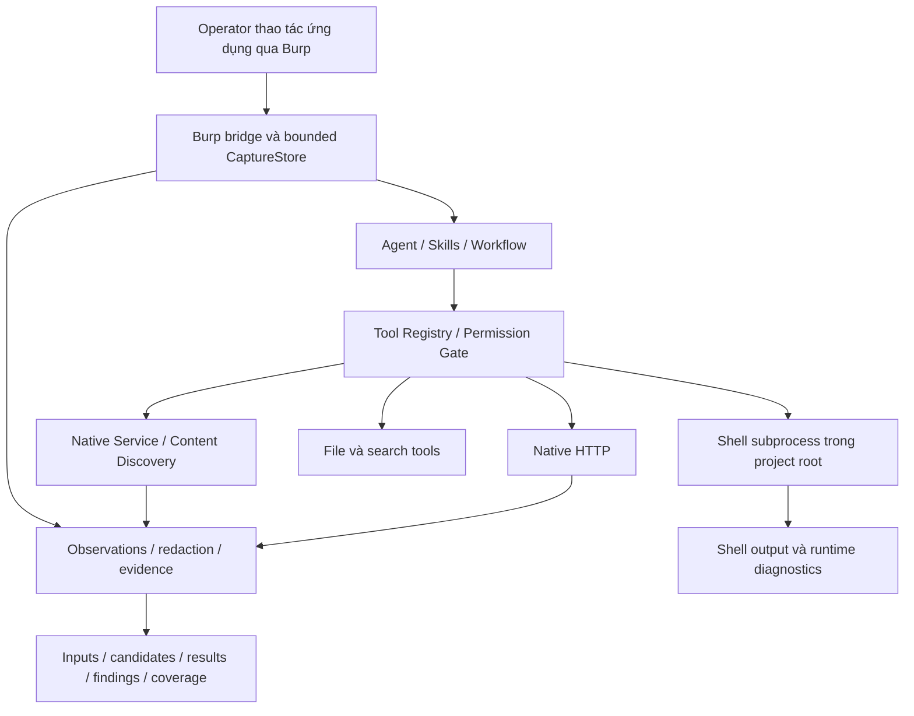

# Thiết kế đề xuất: bỏ worker, Nmap/ffuf và Browser MCP; giữ native discovery và Burp

Trạng thái: đã được operator chốt và triển khai trong session hiện tại.
Contract được đối chiếu tại HEAD `5b1554d`; đầu đợt triển khai chỉ tài liệu này
là untracked, không có tracked changes khác. Xem kết quả và giới hạn tại
[báo cáo triển khai](runtime-simplification-implementation.md).

## 1. Mục tiêu và quyết định

KAgent tập trung vào traffic có nguồn, structured inputs và kiểm chứng HTTP.
Bỏ sandbox worker trong ứng dụng, tích hợp Nmap/ffuf và điều khiển Browser MCP.
Giữ Native Service Discovery, Native Content Discovery, Burp bridge/captures,
HTTP tool, file tools, shell subprocess và workflow.
Một execution path cho shell; cùng hệ đường dẫn project với file tools.

Môi trường triển khai đề xuất là VM/container lab riêng, chạy bằng tài khoản
thường. VM/container do operator quản lý, không phải một worker mới do KAgent
tạo. Không bổ sung scheduler, extraction engine, semantic validator hoặc budget.

“Bỏ scanner ngoài” chỉ bao gồm typed Nmap/ffuf, external wordlist catalog và
readiness/deployment tương ứng. Giữ nguyên hai tools `service_discovery`,
`content_discovery` với backend native và các giới hạn hiện có. Danh sách paths
mặc định/custom paths của native Content Discovery vẫn được giữ; không đánh đồng
với external wordlist catalog. Không cam kết ngăn một shell
command gọi scanner đã cài: shell trực tiếp vẫn là công cụ chạy lệnh tùy ý qua
permission gate. “Bỏ Browser MCP” là bỏ adapter điều khiển trình duyệt tích hợp;
không đồng nghĩa xóa mọi MCP hoặc toàn bộ thư mục `src/browser/`.

## 2. Kiến trúc đích

Burp ingest ghi nhận traffic; ingest không cấp quyền replay hoặc scope cho host
mới. Native HTTP thực hiện request mới hoặc replay capture hợp lệ qua các gate
hiện tại. Workflow vẫn quyết định phase completion và finding eligibility.

## 3. Contract cho từng thành phần

| Thành phần | Quyết định |
| --- | --- |
| Registry và permission/runtime policy | Giữ; sửa adapter contract cho shell trực tiếp một cách tường minh |
| Native HTTP/private-host checks | Giữ exact-origin, private-host gate, credential approval, redirect và capture limits |
| File/search tools | Giữ project roots, protected paths và sensitive-file checks |
| Shell | Một subprocess path, cwd là project root, không `/work` hay broker |
| Worker/broker/relay | Gỡ sau khi xử lý toàn bộ consumer, không chỉ bỏ khởi tạo |
| Nmap/ffuf | Gỡ typed Shell scanner jobs, external wordlist catalog, readiness và execution adapters |
| Native Service Discovery | Giữ registration/schema, native TCP, active host và effective port của target |
| Native Content Discovery | Giữ registration/schema, native HTTP GET, bounded paths, wildcard filtering và workflow hooks |
| Browser MCP | Gỡ launch/deployment, tools, config/CLI/UI wiring riêng |
| Burp | Giữ bridge lifecycle, ingest authentication, capture selection, redaction và bounded retention |
| Session, intelligence, artifacts | Giữ persistence và redaction; lịch sử không cấp quyền mới |
| Command plugins và MCP khác | Không tự chuyển sang host execution; xem mục 7 |

Shell subprocess tiếp tục sử dụng cơ chế capture đang có: stdout/stderr tách
biệt, exit status, timeout, output cap, cancellation và terminate/kill process
group. Tái sử dụng code hiện có, không viết runner thứ hai. Giữ execution
receipts và kiểm tra revoke tại các điểm await trước launch. Approval không
trở thành durable policy; YOLO không thay đổi scope hoặc stop conditions.

Bỏ RLIMIT_AS 512 MiB chung của shell worker. Điều này gỡ nguyên nhân cụ thể
Node/V8 không reserve được CodeRange trong lan-04, không bảo đảm mọi process
sẽ khởi động thành công. Giữ chẩn đoán lỗi thực tế thay vì tự đổi executor.

## 4. Ranh giới bảo đảm sau thay đổi

Subprocess có filesystem/network rights của tài khoản KAgent. Cwd là project
root không phải sandbox. File-tool root check không hạn chế được một lệnh
shell đọc file ngoài project. HTTP exact-origin gate không kiểm soát được
traffic của curl/Python/Node chạy qua shell. Denylist lệnh không thay thế
isolation và không được mô tả như cơ chế bảo đảm scope ở cấp OS.

Permission gate vẫn kiểm tra proposed action; các bảo đảm hard isolation của
worker được bỏ một cách công khai. Runtime/status phải nói shell chạy local
subprocess, không tiếp tục quảng bá isolated filesystem/network. Network
containment của toàn môi trường, nếu cần, thuộc cấu hình VM/container bên ngoài.

## 5. Evidence khi bỏ HTTP broker

Native HTTP, native discovery và captures có provenance hợp lệ tiếp tục đi qua
observation/evidence contracts hiện có; mỗi producer giữ nguyên giới hạn sử dụng
evidence riêng, không tự nâng discovery thành bằng chứng xác nhận lỗ hổng.
Shell output tiếp tục là shell output được sanitize.

HTTP qua shell không còn brokered request/response attestation. Không phân tích
stdout curl thành native HTTP observations, không tự cấp observation ownership
hoặc finding eligibility từ text. Đối với kết luận cần HTTP evidence theo
contract, dùng native HTTP hoặc capture được resolver hiện tại chấp nhận;
thiếu evidence thì giữ outcome chưa đủ bằng chứng. Không thêm fallback parser.

`obs_` và `tr_` giữ nguyên ý nghĩa. Bỏ worker không sửa thay thế cho namespace
validation của result reader. Cache/session/scope/integrity checks vẫn cần giữ.

## 6. Burp và giới hạn browser

Giữ `src/browser/server.py`, `store.py`, `scoped_store.py`, `selection.py`,
`redacted_view.py` cùng native capture tools trong
`src/tools/common/browser_capture.py` theo phụ thuộc thực tế.
Tên module/tool có chữ browser chưa đủ lý do để xóa: chúng đang phục vụ Burp.
Đợt này không đổi tên capture schema/tools hoặc chuyển thư mục hàng loạt.

Burp bridge vẫn có start/stop/status, token bảo vệ ingest và giới hạn kích thước.
Capture list/get, selected-request context và baseline replay phải hoạt động
như trước. Cookie/token không xuất hiện trong logs, inventory hay transcripts.
Không tự đổi native HTTP sang proxy Burp hoặc thêm chức năng remote-control Burp.

Không còn browser navigation/DOM execution tự động. Burp có thể ghi nhận traffic
từ trình duyệt operator, nhưng traffic hoặc reflection không tự chứng minh
JavaScript thực thi. Các bước cần browser giữ kết quả thiếu capability/evidence
theo contract hiện có; không hạ tiêu chuẩn xác nhận XSS. Không sửa thuật toán
SQLi/XSS trong đợt gỡ runtime; chỉ sửa tham chiếu capability đã bị gỡ nếu có.

## 7. Phụ thuộc plugins/MCP phải được xử lý trước khi xóa worker

Hiện `CommandPluginTool`, MCP integration và designated CWE MCP có ràng buộc
worker/receipt/deployment. Xóa worker rồi cho những nhánh này chạy host mặc định
là một thay đổi quyền ngoài mục tiêu tối giản.

Quyết định đề xuất cho bản đầu: giữ cấu hình đã lưu nhưng không đăng ký các
adapter vẫn yêu cầu worker; runtime báo unavailable với nguyên nhân rõ ràng.
Không xuất tool schema của adapter không thể chạy, không âm thầm bỏ cấu hình,
không fallback direct. Nếu cần giữ một plugin/MCP cụ thể, review direct-execution
contract của nó trong task riêng. Đây là hệ quả cần được chấp nhận khi duyệt
thiết kế, không phải chi tiết có thể bỏ qua lúc implementation.

Browser MCP tích hợp bị gỡ khỏi supported runtime. Không nhận diện mọi custom
MCP là Browser MCP chỉ dựa vào tên profile hoặc command text suy đoán.

## 8. Luồng assessment mới

1. Xác lập target/scope và khả năng truy cập qua native HTTP; dùng native
   `service_discovery` khi cần kiểm tra active host/effective HTTP port theo
   contract hiện có. Không tự mở sang port khác hoặc mạng khác.
2. Tận dụng Burp captures; đọc HTML/form/link, API documentation và phần JS có
   thể xem trong giới hạn hiện tại. Dùng native `content_discovery` khi còn
   khoảng trống đường dẫn thực tế: giữ bounded paths, request/rate/timeout caps,
   exact-origin, GET-only, không recursion và không follow redirects.
3. Ghi từng input ngay khi có method/endpoint/parameter/location được chứng minh.
   Document attribution không trở thành baseline/replay authority.
4. Viết canonical inventory, nêu phần chưa xem, kiểm tra source obligations và
   khai báo coverage trung thực; complete Enumeration khi gate hiện tại cho phép.
5. Input analysis chọn hypotheses từ inputs đã ghi; validation dùng request cụ
   thể và evidence hiện có. Không tự viết shell scan loop để thay Nmap/ffuf.

Không bắt đọc hết bundles. Không suy đoán schema từ tên route. Không khẳng định
khảo sát toàn bộ ứng dụng chỉ vì đã kết thúc một bounded enumeration pass.

Direct giữ hành vi theo yêu cầu cụ thể. Whole-target giữ thứ tự phase và các
goals đang pending. Continue dùng canonical state, không tự reset inputs,
attempts hoặc requested goals và không chạy lại discovery để làm mới receipts.

## 9. Coverage và dữ liệu cũ

Giữ coverage dimensions/schema và machine attestation của native discovery.
`service_discovery` và `active_content_discovery` tiếp tục được runtime ghi nhận
khi producer native thực sự chạy theo contract. Bỏ Nmap/ffuf không phải lý do
tự bỏ qua hai dimensions này, cũng không bắt buộc chạy chỉ để lấy receipt.
Với thao tác thực sự bỏ qua, ghi skipped và lý do; not_applicable chỉ khi thực
sự không áp dụng. Không tự khai performed.
Một failed/cancelled record không bị startup tự sửa thành skipped. Review và
giải thích disposition qua contract hiện có. Không dùng coverage để lấp thiếu
source review, inventory hoặc structured inputs.

Session cũ tiếp tục đọc được scanner jobs, Browser records, references và
artifacts như lịch sử. Không dùng metadata lịch sử để khởi chạy adapter đã gỡ.
Không xóa dữ liệu dự án/user, không rewrite kết quả cũ hoặc gán provenance mới.
Evidence lịch sử được kiểm tra bằng resolver hiện có; không tự nâng thành
eligible cũng không tự sửa immutable evidence để hợp với executor mới.

Giữ model/store classes và read projections cần cho hydration; gỡ execution
paths trước. Cleanup schema/model lịch sử là việc riêng khi có migration rõ.

## 10. Bản đồ thay đổi dự kiến

| Nhóm source hiện tại | Công việc |
| --- | --- |
| `src/cli/runtime.py`, CLI flags/config, startup/UI | Gỡ wiring Nmap/ffuf và Browser MCP; giữ registration/init của native discovery và Burp; công bố process mode thật |
| `src/tools/execution/shell.py` | Gỡ scanner schema/dispatch và worker wrapping; thống nhất project cwd và reuse subprocess capture |
| `src/permission/runtime/execution.py` | Bỏ yêu cầu worker riêng cho shell và nhánh backend ngoài đã gỡ; giữ registry gates, receipts, revoke, native discovery và HTTP/file guards |
| `src/permission/worker/{worker,broker,relay}.py` | Xóa khi không còn consumer; không để host fallback ngầm |
| `src/tools/execution/scanner*.py`, `wordlists.py` và bundled external wordlists | Gỡ execution/catalog Nmap/ffuf sau khi kiểm tra consumer và session compatibility |
| `src/tools/discovery/{service,content}.py` | Giữ hai tools, native backends, schema compatibility và runtime hooks; chỉ bỏ hướng dẫn gọi Nmap/ffuf cùng dead external-backend branches |
| `src/tools/mcp/{browser_deployment,browser_local,session_servers,integration}.py` | Gỡ nhánh browser; xử lý phụ thuộc worker của MCP khác tường minh |
| `src/browser/` và native capture tools | Review từng file; giữ Burp, không xóa cả thư mục |
| `skills/recon`, `skills/web-enumeration`, guidance/status | Bỏ chỉ dẫn Nmap/ffuf/Browser MCP; giữ native discovery theo gaps, incremental recording, limitations và completion contract |
| Tests, dependencies, deployment docs | Thay isolation assertions theo contract mới, gỡ dependencies chỉ khi không consumer |

Danh sách là change map để điều tra implementation, không phải lệnh xóa nguyên
thư mục. Giữ native-discovery provenance/retention và workflow hooks đang chạy;
gỡ external scanner execution phải giữ khả năng đọc lịch sử an toàn.

## 11. Thứ tự triển khai và acceptance

Thực hiện trong một nhánh thay đổi có thể review theo nhóm, không thêm hai
execution modes lâu dài hoặc cờ fallback tự động:

1. Chốt contract subprocess, evidence và adapter unavailable; viết regressions.
2. Chuyển shell và policy wiring; giữ capture/cancel/redaction behavior.
3. Gỡ Nmap/ffuf adapters/catalog/flags và Browser MCP init/UI; giữ native
   discovery cùng Burp tests xanh.
4. Gỡ worker/broker khi hết consumer; cập nhật playbooks, coverage guidance và
   đọc session cũ. Không migrate dữ liệu bằng thao tác xóa.
5. Inspect diff/status, targeted tests, Pyright và whitespace checks.

Acceptance offline tối thiểu:

- Không còn typed Nmap/ffuf hoặc Browser MCP trong advertised tools/CLI help;
  `service_discovery` và `content_discovery` vẫn được quảng bá và chạy native.
  Flags đã bỏ trả lỗi rõ, không silently ignore. Không còn bwrap/broker khi chạy shell.
- Shell dùng project cwd, exit/stdout/stderr trung thực; timeout/cancel dọn process
  group; output cap/redaction giữ nguyên; deny/revoke còn hiệu lực.
- Native HTTP/file tools tiếp tục reject scope/path/credentials không hợp lệ.
  Không có test giả rằng arbitrary shell còn bị OS isolation.
- Native Service Discovery vẫn chỉ kiểm tra active host/effective port;
  Content Discovery giữ exact-origin, paths/extensions, wildcard baselines,
  request/rate/timeout limits, cancellation và native observations/coverage.
  Hai tools không cần Nmap/ffuf, worker hoặc Browser MCP để chạy.
- Burp ingest token/limits, capture selection, request binding và replay gates
  hoạt động; không cần Browser MCP hay worker để dùng Burp.
- Enumeration offline ghi document-attributed inputs, inventory và coverage
  trung thực rồi complete; không cần Nmap/ffuf hoặc đọc hết JS. Coverage từ
  native discovery đã thực hiện tiếp tục được runtime attestation như trước.
- Direct/Whole-target/Session/Continue giữ semantics; session cũ có retired
  scanner/browser records hydrate được mà không dispatch chúng.
- Evidence không nhận shell stdout thay brokered HTTP receipts; reader tr_/obs_
  và scope/ownership checks giữ nguyên. Không giảm chuẩn finding confirmation.

Các mục trên là implementation contract đã chốt. Kiểm chứng implementation
được ghi riêng trong báo cáo; không gọi LLM/API, không chạy live target,
không xóa dữ liệu lịch sử hoặc uninstall packages.

## Bổ sung sau triển khai: scanner history và CWE local

Theo yêu cầu tiếp theo của operator, gỡ cả scanner result normalization,
private artifact reader/writer, workflow handoff/triage và scanner presentation.
Không đổi tên các implementation này để giữ chúng chạy ngầm. Chỉ giữ hai
trường metadata bounded trong session để không xóa lịch sử; không dùng chúng
làm prompt, progress, coverage hoặc capability. Scanner SourceRecord cũ vẫn
hydrate để giữ provenance; admission mới bị từ chối. Các source limitation cũ
không tự được xem là đã giải quyết.

CWE retrieval dùng Catalog Python đã có trong repository, trong process.
`cwe_mcp_deployment_path` giữ nguyên làm config path dữ liệu, không dùng để
import/chạy code. Chỉ đọc manifest và XML được pin, giữ bounds và validation.
Không khôi phục designated CWE MCP, Worker, host MCP execution hoặc tool mới.
Bản gỡ runtime ban đầu chưa nối helper vào CLI/TUI/agent. Theo yêu cầu bổ sung
của operator, nay nối automatic enrichment khi confirm_finding thiếu mapping và
/cwe cho review thủ công; không thêm model tool, MCP hoặc subprocess. Xem
docs/cwe-enrichment.md về điều kiện lựa chọn và persistence.
